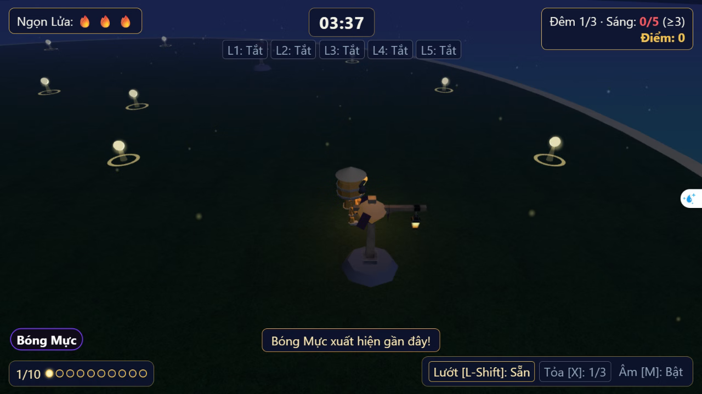

# Đảo Đèn Lồng (Lantern Island) — v1.0.0 (Day 12 AI SDLC)



> **Video Demo & Bản phát hành:** Xem [`docs/demo/demo.mp4`](docs/demo/demo.mp4) hoặc tải gói chạy trực tiếp tại **GitHub Release `v1.0.0`**.

Game 3D góc nhìn thứ ba qua **3 Đêm (Đảo Bến – Đảo Cau – Đảo Chuông)** theo luật **"Đèn cạn dầu"** (`Contract v1.3`): **Mây** (đội nón lá treo chiếc đèn lồng nhỏ) gom đom đóm, thắp sáng và châm dầu giữ các Đèn Lồng Lớn sáng qua sương mù tới bình minh, né tránh Gió Lạc và ngăn Bóng Mực hút cạn dầu.

---

## Cài đặt & Chạy nhanh (3 lệnh)

Yêu cầu hệ thống:
- **Node.js `>= 20`** & **`npm`**
- Trình duyệt hỗ trợ WebGL2 (Chrome / Microsoft Edge / Chromium), khuyến nghị độ phân giải tối thiểu `1280×720`.

```bash
npm install
npm run build
npm run dev
```

*(Hoặc mở bản build tĩnh sau `npm run build`: `npm run preview`, hoặc dùng `node scripts/run.mjs`)*

---

## Điều khiển & Hỗ trợ tiếp cận

- **Phím mặc định (có thể đổi toàn bộ trong Cài đặt):**
  - **Di chuyển:** `W / A / S / D` · **Nhảy:** `Space` · **Lướt:** `Shift trái` (`14 m/s`, `0.2s`, hồi `1.5s`)
  - **Thắp đèn / Thắp lại / Châm dầu:** `E` (trong bán kính `2.0m`)
  - **Tỏa Sáng (Pulse):** `X` hoặc **Chuột phải** (tốn `3` đom đóm, bán kính 3D `5m`, hồi `3s`)
  - **Xoay Camera 3D:** Kéo chuột trái hoặc `Q / C` · **Tạm dừng:** `Esc` (hoặc `P`) · **Chơi lại Đêm:** `R` · **Âm thanh:** `M`
- **Tính năng tiếp cận (`TICKET-04`):**
  - Đổi 9 phím điều khiển kèm **phát hiện trùng phím** & nút **"Khôi phục mặc định"** (lưu `localStorage`).
  - **Cỡ chữ UI tối thiểu `18px`** tại `1280×720` và tùy chọn **Chữ lớn (`×1.25`)**.
  - **Phụ đề sự kiện** & mũi tên mép màn hình: Bóng Mực xuất hiện (kèm hướng), Gió mạnh sắp thổi, 10 giây cuối, và Đèn có `fuel < 30`.
  - **Giảm chuyển động** (tắt rung lắc & nhấp nháy) và **Bảng màu dễ phân biệt** (`#00B3FF` cho Bóng Mực, `#FFFFFF + ⚠` cho cảnh báo HUD).
- **Bảng xếp hạng cục bộ (Top 10):** Cho phép nhập tên (`3–12` ký tự) sau khi thắng Bình Minh Đêm 3 hoặc thua ở bất kỳ Đêm nào; lưu bền vững cả trên trình duyệt (`localStorage`) và đĩa cục bộ (`.leaderboard.json`).

---

## Chạy Test, Headless, Benchmark, Soak & Xếp hạng (`Test Contract v1.3`)

- **Unit & Contract Tests (`Vitest`):**
  ```bash
  npm test
  ```
- **Chế độ Headless (`--night 1 | 2 | 3`):**
  ```bash
  node dist-headless/cli.js --seed 2026 --night 1 --scenario tests/scenarios/p3-fuel-refuel-relight.scenario.json --inputs tests/scenarios/p3-fuel-refuel-relight.inputs.json --ticks 200 --out out.jsonl --snapshot-every 10
  ```
- **Chế độ Benchmark 3D (`1280×720`, 30s đo + 3s khởi động, tắt vsync, 200 Bóng Mực & 100 đom đóm):**
  ```bash
  node scripts/bench.mjs --seed 42 --duration 30 --out bench.json
  ```
  > *Ghi chú `vsync_off`:* `bench.mjs` mở Chromium/Chrome với `--disable-frame-rate-limit --disable-gpu-vsync` nên `vsync_off` là `true` (đo thực tế trên Intel Iris Xe Windows 11 đạt `avg_fps: 175.9`, `p1_low_fps: 78.3`, `load_ms: 543`).
- **Soak Test Headless (10 Đêm liên tiếp trong cùng một tiến trình):**
  ```bash
  node --max-semi-space-size=1 scripts/soak.mjs --seed 7 --nights 10 --out soak.json
  ```
- **Xuất Bảng xếp hạng cục bộ JSON:**
  ```bash
  node scripts/run.mjs --export-leaderboard out.json
  ```
- **Chạy toàn bộ bộ kiểm chứng tổng hợp:**
  ```bash
  npm run verify
  ```

---

## Luật chơi tóm tắt (`Contract v1.3`)

Thông số chuẩn nằm tại [`game.contract.json`](game.contract.json) và quyết định thiết kế tại [`docs/notes/adr-001-phase3-lantern-fuel-and-dawn.md`](docs/notes/adr-001-phase3-lantern-fuel-and-dawn.md):
- **Nhiên liệu & Vùng an toàn:** Đèn thắp sáng mang `fuel = 100`, hao `1.0/s`; dưới `30` mất vùng an toàn `6m` và bị Bóng Mực `wander` tới hút `5/s` (`drain`). Cạn về `0` đèn tắt (`lantern_out`), thắp lại tốn `5` đom đóm (lần đầu `10`).
- **Sức chứa túi & Bình Minh:** Sức chứa tăng `10 → 20` (`10 + 2 × successful_lights`). Sống sót tới hết Đêm (`240s / 270s / 300s`) và giữ sáng `>= ceil(0.6 × tổng đèn)` (**`3/5`**, **`4/6`**, **`5/7`**) để thắng `dawn_survived` (thua khi thiếu đèn phát `reason: "lanterns_short"`).

---

## Sáng tạo của tôi

- **Tách biệt 100% tại tầng trình bày (`src/render/`), không đổi đầu ra headless và tự động tắt trong chế độ benchmark/soak:**
  - **Nhân vật & Khung cảnh 3D:** Mây (`RobotExpressive.glb` đội nón lá + đèn treo tay), Bóng Mực (`Fox.glb` hiệu ứng mực tím `#7A3CFF` / xanh mù màu `#00B3FF`), Đèn Lồng Lớn (`Lantern.glb` xẹp `20%` kèm dải rách khi tắt, thanh dầu 3D + nhấp nháy `1 Hz` khi yếu, tia siphon hút dầu khi `drain`), hạt đom đóm bay & lá gió Đêm 3, âm thanh WebAudio tổng hợp thời gian thực.
  - **Tách sạch cảnh chuẩn Benchmark (`GameScene(..., true)`):** Tắt hoàn toàn GLTF skin sáng tạo và lớp hạt môi trường, chỉ dùng hình học chuẩn (`InstancedMesh` cho 200 Bóng Mực và 100 đom đóm + camera quỹ đạo bán kính `30m`, `Y=15m`).
- **Bằng chứng không ảnh hưởng phần lõi:** `npm run verify` kiểm chứng `8/8` scenarios khớp từng byte qua `dist-headless/cli.js`, `7/7` Vitest tests, soak test `10` Đêm `0` crash, và benchmark `175.9 avg FPS` (`bench.json`).
